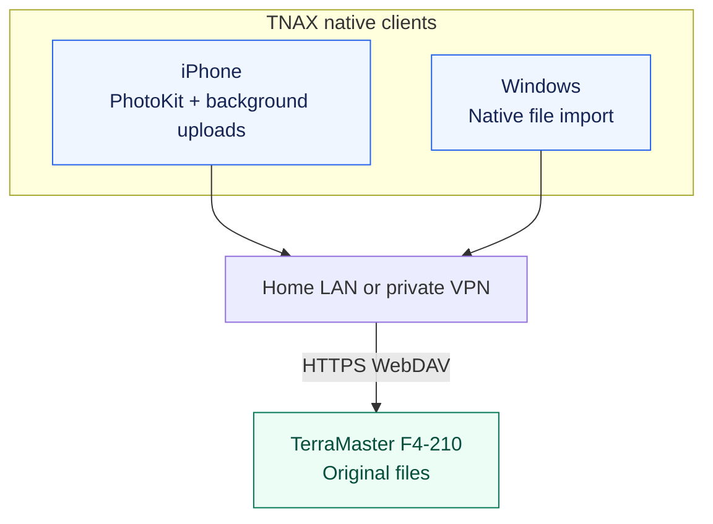

# TNAX Decisions

[PLAN.md](PLAN.md) | [SHELVED/TODO.md](SHELVED/TODO.md)

Confirmed = user requirement. Adopted = engineering default. Proposed = needs a feasibility check. Supersede decisions explicitly instead of erasing their rationale.

## Decision Log

| ID | Status | Decision | Reason / Gate |
| --- | --- | --- | --- |
| D01 | Confirmed | Build our own desktop and iPhone app, with home and away backup | The goal is a native family workflow, not another TNAS PC launcher or an existing replacement product |
| D02 | Adopted | .NET 10 MAUI for Windows/iOS; shared C# backup core | Windows build runs; iPhone managed source compiles. Full Mac packaging and device validation remain gates |
| D03 | Proposed | Direct HTTPS WebDAV; no application server on the NAS | Avoid undocumented TerraMaster APIs and extra F4-210 workload; first verify service support and required protocol behavior |
| D04 | Adopted | Home LAN locally; private VPN when away | No public NAS/admin/SMB/WebDAV ports; use a supported router or separate subnet gateway unless NAS support is verified |
| D05 | Adopted | Copy-only, per-person/device destinations, idempotent create-only uploads | Retries must not overwrite another file or propagate deletions; hash-check collisions before accepting an existing object |
| D06 | Adopted | Device-local SQLite journal with per-resource state and bounded staging | Restart and asset-accounting tests pass; use sqlite-net-base with the maintained SQLitePCLRaw 3.x bundle, not the vulnerable legacy native bundle |
| D07 | Adopted | PhotoKit exports and file-backed background URLSession uploads on iOS | A PWA cannot deliver the required Photos integration; discovery/export scheduling remains opportunistic |
| D08 | Adopted | Dedicated non-admin NAS accounts; credentials in OS secure storage | Keep passwords out of source, URLs, logs, and ordinary preferences; preserve certificate checks using system trust or the scoped CA in D10 |
| D09 | Adopted | Original media first; no hosted app backend or analytics | Keep family photos on the existing NAS; defer gallery and synchronization features |
| D10 | Adopted | Owner-created, public-only pairing files with app-local CA trust | User approved; family members import, sign in, and choose a folder without installing a system CA. Trust is restricted to the configured HTTPS host/port |

Pairing preserves hostname, expiry, chain, and server-purpose checks. Files must arrive through a trusted owner channel and require explicit confirmation. Private-CA validation stays offline; CA compromise requires removing/replacing the pairing, not relying on online revocation. iOS foreground and background trust still require physical-device verification.

## Target Architecture

Implemented client architecture; D03 still requires validation on the actual NAS.

Shared C# code runs on each device, not on a server. Each installation owns its journal and credentials. WebDAV paths must be confirmed; a TOS filesystem path is not automatically a WebDAV URL.

## Backup Contract

- **Asset:** one photo/video plus every required resource. A Live Photo is not complete with only its still image.
- **Server-confirmed:** the expected remote resource exists with the expected length; this is not an integrity guarantee.
- **Content-verified:** remote bytes match the source SHA-256, through read-back or a trustworthy server checksum. An ETag alone is not a checksum.
- **Completed asset:** all required resources are content-verified and their identities/pairing are recorded durably. No deletion follows completion.
- **Retry:** reconcile remote state after ambiguous failures; reuse the same destination and never silently replace different content.

The prototype caps staging at 2 GiB and imports at most 24 iPhone assets per scan. Native scheduling is limited to 48 resources per pass. Staged originals must still match their journaled hashes before upload.

## Platform Boundaries

- iOS background transfers upload staged files. Background discovery/export is system-scheduled, not guaranteed continuous backup.
- Full, Limited, and Denied Photos access must remain visible. iCloud-only originals may require an allowed network download before staging.
- Wi-Fi-only is the default, including verification and original downloads. Cellular requires explicit opt-in.
- Background URLSession follows redirects automatically. Before shipping, prove that endpoint behavior cannot redirect uploads or credentials to an unintended destination.
- TestFlight and physical-device validation require the user's Mac, compatible Xcode, and signing setup. Windows tests cannot establish iOS behavior.

If WebDAV, certificate handling, or native integrations fail their gates, record the evidence and revise the affected decision before adding a bridge, alternate client stack, or deployment work.
