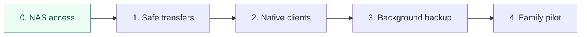

# TNAX Plan

Native Windows and iPhone apps for dependable family photo backup to our NAS, at home and away.

[Repository](https://github.com/Azayzel/tnax) | [README.md](README.md) | [DECISIONS.md](DECISIONS.md) | [SHELVED/TODO.md](SHELVED/TODO.md)

## Current State

Development prototype implemented. Windows builds; 44 shared tests pass, including scoped TLS transport tests. Guided pairing and folder browsing are implemented. iPhone C# passes a design-time compile, not a signed native build. Authenticated NAS access and live uploads remain unverified.

| Item | Baseline on 2026-11-16 |
| --- | --- |
| NAS | TerraMaster F4-210; TOS 4.2.x shown in the user's screenshot |
| Local address | `tnas` / `192.168.0.87`; MAC `6C-BF-B5-03-19-41` |
| Connectivity | WebDAV HTTP 8800 advertises DAV 1/2; HTTPS 474 rejects certificate validation (invalid signature/untrusted root) |
| Upload protocol | Requested share `https://192.168.0.87:474/LavelyIO/`; authentication and folder access unverified |
| Replacement certificate | Covers the NAS IP and hostname and is trusted locally, but port 474 still serves the factory certificate |
| Development | Windows; .NET 10 and MAUI workloads available |
| Apple delivery | Mac and Apple Developer membership available; Mac/Xcode setup unchecked |
| Git | Local `main` initialized; `origin` points to `https://github.com/Azayzel/tnax.git` |

The 8800 OPTIONS response confirms WebDAV advertising, not authenticated read/write access or the cause of TNAS PC's failure. Do not use the TOS admin URL as an upload endpoint.

## Delivery

NAS-dependent release gates remain pending; local implementation and fake-server tests have proceeded without NAS writes.

| Workstream | Evidence / Status |
| --- | --- |
| Transfer core | 44 tests pass: HTTPS/path checks, folder discovery, scoped CA pairing, create-only upload, hashes, journal recovery, asset accounting |
| Windows client | Native build succeeds; guided pairing import/export and folder picker implemented |
| iPhone client | Photos export, manifests, background URLSession, and processing hooks implemented; managed-source compile passes |
| Still blocked | Trusted HTTPS certificate and shared-folder mapping, real NAS contract tests, Mac packaging/signing, iPhone behavior, VPN route |

| Phase | Deliverable | Exit Check |
| --- | --- | --- |
| 0. NAS access | Confirm TOS, HTTPS WebDAV, destination, and private VPN route | Read-only authenticated folder probe succeeds locally and through the VPN; certificate validation stays enabled |
| 1. Safe transfers | Shared transfer core, deterministic destinations, create-only writes, and hash verification | Fake-server tests pass; an explicitly authorized disposable-file test proves upload, read-back, and no overwrite on the NAS |
| 2. Native clients | Connection, Backup, and Activity views; Windows file import; iPhone Photos resource export | Windows build and physical-iPhone build run; Full/Limited/Denied access, HEIC, video, and Live Photo pairs are handled honestly |
| 3. Background backup | Durable resource journal, bounded staging, retries, Wi-Fi default, and native background uploads | Device tests cover interruption, locking, suspension, relaunch, unavailable iCloud originals, and retry without duplicate writes |
| 4. Family pilot | Signed Windows package and iPhone TestFlight build | Both users back up and recover original files at home and away; all required resources pass hash checks |

## Next Actions

- [x] Identify TOS 4.2.x and configured WebDAV ports from the screenshot; probe the listeners without credentials.
- [x] Record the requested share and verify local replacement-certificate generation and trust.
- [x] Add password-free family pairing and authenticated folder selection; keep manual controls under Advanced.
- [ ] Assign the replacement certificate specifically to WebDAV on port 474 and verify it is served.
- [ ] Establish a dedicated, least-privilege NAS account per person and verify the selected folder.
- [ ] Enable WebDAV permission for the selected share in TOS Shared Folder Settings.
- [ ] Choose a supported VPN gateway; test the remote route from cellular, not home Wi-Fi.
- [x] Initialize local Git on `main` and attach the supplied GitHub repository.
- [ ] Run the full iPhone build on the Mac; the Windows native iOS build currently stops at a missing-workload check.
- [ ] Prove automatic background scheduling, redirect safety, cellular policy, and Live Photo recovery on a physical iPhone.
- [ ] Exercise the end-to-end app workflow against a disposable WebDAV server before connecting family originals.

NAS configuration changes and live write tests require explicit approval. If WebDAV is unsuitable, revisit the protocol decision before building around it.

## Release Bar

- Preserve original bytes and all required Live Photo resources; never delete phone or NAS originals.
- Separate pending, failed, server-confirmed, and content-verified states. No optimistic "backed up" counts.
- Recover after interrupted transfers; reject unsafe redirects, untrusted TLS, and silent overwrites.
- Respect Photos permissions and Wi-Fi-only settings; require explicit cellular opt-in.
- Verify real-device background behavior and VPN access. iOS decides scheduling; force-quit recovery requires reopening.

Keep existing backups throughout the pilot. A NAS copy is not an off-site backup or a complete Apple Photos library replica.

## Tracking

Keep active milestones here, architecture rationale in [DECISIONS.md](DECISIONS.md), and deferred scope in [SHELVED/TODO.md](SHELVED/TODO.md). Update phase status with test evidence, not just code completion.
